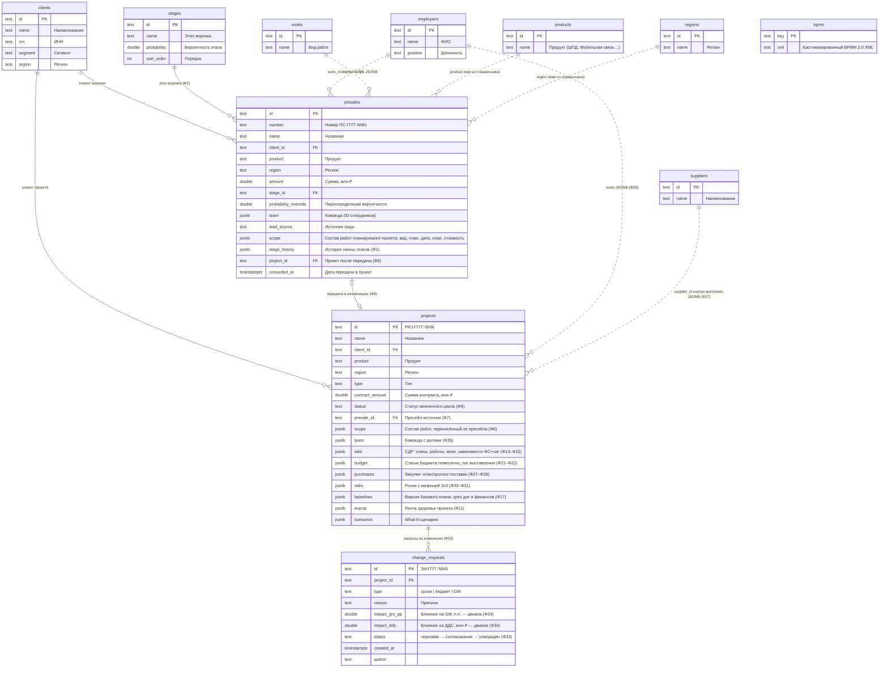

# ИСУП — прототип (MVP) системы управления проектами B2B

B2B Телеком · портфель **«Цифровизация B2B»** (директор — Иванов И.И.)

Единый E2E-контур от пресейла до завершения проекта: воронка продаж, карточка проекта,
СДР и диаграмма Ганта, финансы и ДДС, закупки, риски, запросы на изменение, what-if песочница,
ИИ-ассистент, генерация спецификаций в нотациях BPMN и C4.

## Быстрый запуск (Docker)

```bash
docker compose up --build
```

После сборки:

| Что | Адрес |
|---|---|
| Web-интерфейс (React) | http://localhost |
| REST API (Go) | http://localhost:9080/api/portfolio |
| PostgreSQL 16 (внешний доступ) | localhost:5433 (isup/isup, БД isup) |

**Данные хранятся в PostgreSQL** (сервис `db`, volume `isup-pgdata`): при первом старте
демо-данные портфеля прогружаются в БД, далее состояние переживает рестарты контейнеров —
созданные пресейлы, изменённые этапы воронки и графики сохраняются. Сброс к исходным
демо-данным: `docker compose down -v && docker compose up -d`.

Остановка: `docker compose down`. Порты 9080/5433 выбраны, чтобы не конфликтовать
с часто занятыми 8080/5432. Если нужно другое — правьте `docker-compose.yml`.

## Локальная разработка без Docker

```bash
# бэкенд (порт 8080)
cd backend && go run ./cmd/server

# фронтенд (порт 5173, /api проксируется на :8080)
cd frontend && npm install && npm run dev

# автотесты расчётного движка
cd backend && go test ./...
```

## Состав системы

```
icp/
├── backend/                # Go 1.25, из внешних зависимостей — pgx (PostgreSQL)
│   ├── cmd/server/         # точка входа (ISUP_DB_DSN включает хранение в PostgreSQL)
│   └── internal/
│       ├── model/          # доменная модель (требование «Доменная модель»)
│       ├── store/          # хранилище + демо-данные портфеля (без DSN — в памяти)
│       ├── pg/             # персистентность в PostgreSQL (схема, Sync, LoadInto)
│       ├── engine/         # РАСЧЁТНЫЙ ДВИЖОК + автотесты
│       ├── api/            # REST API (после изменений состояние синхронизируется в БД)
│       ├── ai/             # интерфейс ИИ-провайдера + DemoProvider
│       ├── bpmn/           # генератор BPMN 2.0 XML (для bpmn-js)
│       └── c4/             # генератор C4-спек (Mermaid + Structurizr DSL)
├── frontend/               # React 18 + TypeScript + Ant Design (Vite)
│   └── src/
│       ├── pages/          # портфель, проекты, пресейлы, ЗИ, BPMN, C4, справочники
│       ├── pages/project/  # вкладки карточки проекта (Гант, финансы, риски, песочница…)
│       └── components/     # диаграмма Ганта (SVG), ИИ-чат, адаптивный Layout
└── docker-compose.yml      # backend + frontend + postgres (volume isup-pgdata)
```

Open source-компоненты: **React, Ant Design, bpmn-js** (редактор BPMN от Camunda — встраиваемый
аналог OpenBPMN), **Mermaid** (рендер C4), **Recharts**, **@dnd-kit** (канбан), nginx, Go.

## Реализованные функциональные требования

| Раздел | Что сделано |
|---|---|
| Пресейл (Ф1–Ф6) | Карточки пресейлов (в т.ч. **заведение новых из интерфейса** — кнопка «Новый пресейл»: плановая выручка + **состав работ планируемого проекта** из справочника видов работ с плановой датой и стоимостью по каждой строке; номер ПС-ГГГГ-NNN присваивается автоматически), воронка-канбан с drag&drop (при смене этапа пересчитывается взвешенная сумма), метрики этапов (кол-во/сумма/взвешенная), конверсии, передача в проект одной кнопкой с переносом данных и состава работ |
| Проекты (Ф7–Ф12) | Реестр со здоровьем 🟢🟡🔴 и тултипом причины, колонки «Плановая выручка от проекта» и «Плановые затраты» (сумма затрат строк состава работ), **GM план = (выручка − затраты) / выручка × 100%**, «Завершение (прогноз)» — самая большая плановая дата состава работ; карточка проекта, статусы жизненного цикла, лента событий, справочники (клиенты, поставщики, сотрудники, виды работ, продукты, регионы) с **заведением новых позиций из интерфейса** (хранение в PostgreSQL) |
| СДР и Гант (Ф13–Ф20) | Два уровня декомпозиции + вехи, SVG-Гант с базовым планом (пунктир) и подсветкой сдвигов, зависимости «финиш-старт + лаг», карточка привязок вехи (закупка/выручка), подсветка связи по клику, каскадный пересчёт, предупреждение перед изменением закупки с числом затронутых задач и вех |
| Финансы и ДДС (Ф21–Ф26) | Бюджет по статьям помесячно (март–июнь 2024): Выручка/Оборудование/Работы/Подряд/Прочее; план/прогноз/факт; GM итог и помесячно; ДДС с кассовым разрывом; факт — модуль-заглушка «OEBS» с меткой синхронизации; пересчёт месяцев выручки/затрат при сдвиге вех |
| Закупки (Ф27–Ф29) | Номера З-ГГГГ-NNN, статусы, план/прогноз поставки, влияние задержки на график и финансы; **импорт состава оборудования из Excel** (столбцы: наименование, количество) — сервис парсит файл и сохраняет позиции в связке с проектом, присваивая случайные сумму и прогнозную дату поставки; статусы оборудования — справочник «Планируется / В закупке / Доставлено»; «Проставить задержки» задаёт дату задержки по каждой строке (случайно, позже прогноза, не более года); если в составе работ есть «Поставка оборудования», вкладка закупок выделяется жирным |
| Сметный расчёт на работы | Вкладка карточки проекта: **импорт Excel** (столбец 1 — работа, столбец 2 — объём работ), сервис парсит строки, сохраняет в связке с проектом и присваивает случайную сумму (0,1–2,0 млн ₽), итог по смете; вкладка выделяется жирным при работах «Пусконаладочные работы / Проектирование решения / Интеграция и тестирование / Монтажные работы» в составе |
| Риски (Ф30–Ф32) | Карта рисков, матрица 3×3, здоровье по формулам (сроки/выручка/GM) с порогами; для проектов с составом работ: сроки — последняя дата состава (для «Поставки оборудования» — с задержками оборудования), выручка — (состав × 1,4) / план × 100, GM — разница план/прогноз; факт-суммы строк оборудования и сметы вводятся руками с ограничением ≤ суммы строки |
| Запросы на изменение (Ф33–Ф34) | Реестр, маршрут черновик → на согласовании → утверждён, влияние (GM п.п., ДДС млн ₽) считается движком автоматически, утверждение создаёт новую версию базового плана |
| Ресурсы (Ф35) | Команда проекта с ролями (РП, инженер, менеджер по закупкам) |
| Портфель (Ф36–Ф37) | Дашборд директора: выручка план/прогноз/факт, GM взвешенно по выручке, ДДС по месяцам, взвешенная воронка, вкладка «Пресейлы» |
| ИИ (Ф38–Ф40) | Чат-бот в правом нижнем углу (ответы из данных движка, fallback «Я демо-ассистент ИСУП…»), проактивные отклонения с ИИ-объяснением последствий, черновик статус-отчёта с кнопкой «Скопировать» |
| Дополнения 4.1.5 | Генерация спек в C4 (контекст/контейнеры + Structurizr DSL), генерация и правка BPMN в трёх разрезах, автотесты (`go test ./...`) |

## Архитектурные решения

- **Хранение в PostgreSQL** — `internal/pg`: таблицы для справочников, пресейлов, проектов
  (вложенные структуры движка — СДР, бюджет, базовые планы, лента — в JSONB-колонках),
  ЗИ и кастомизированных BPMN. После каждого изменяющегошего запроса API состояние
  синхронизируется в БД одной транзакцией; при старте — загружается из БД
  (пустая БД → прогрузка демо-данных). Без `ISUP_DB_DSN` сервер работает в памяти
  (локальная разработка, автотесты).
- **Запрет хардкода (4.1.4)** — все числа на экранах (отклонения, GM, ДДС, здоровье,
  взвешенная воронка, влияние ЗИ) вычисляет бэкенд-движок `internal/engine`; интерфейс
  только отображает ответы API. Контрольная проверка встроена в автотесты:
  `TestShiftFourWeeksChangesNumbers` — при сдвиге поставки на 4 недели вместо 3
  все рассчитанные величины изменяются.
- **Интерфейс ИИ-провайдера** — `internal/ai.Provider` (`Chat`, `StatusReport`,
  `Recommendations`). Сейчас подключена детерминированная реализация `DemoProvider`
  поверх данных движка; в пилоте вместо неё подключается LLM без изменения остального кода.
- **Расчётная модель** — зависимости только «финиш-старт» с лагом в днях; веха, привязанная
  к закупке, следует её прогнозной дате; финансовые привязки «едут» за вехой-якорём
  (сдвиг месяцев = разница прогноз/базовый план); сценарии пересчитываются «плотно»
  (сокращение работ тянет преемников назад), текущий прогноз — только вперёд (накопленные задержки).
- **Внешние интеграции** заменены заглушкой по требованию 4.1.2: факт поступает из
  предзагруженных данных «OEBS-факт», в карточке проекта видна метка последней синхронизации.

## Модель данных (ER-диаграмма)


Физическая модель — таблицы PostgreSQL (схема создаётся бэкендом `internal/pg`).
Ключевые сущности предметной области — первоклассные таблицы; вложенные структуры
проекта (СДР, бюджет, закупки, риски, базовые планы, лента, сценарии) — JSONB-колонки
таблицы `projects`, т.к. они пересчитываются движком как единое целое.




Внутренние ссылки внутри JSONB проекта (не видны СУБД, соблюдаются движком):
веха СДР ← закупка (`purchases.milestoneId`), статья бюджета ← веха-якорь
(`budget.milestoneId`), работа/веха ← зависимости `wbs.dependencies[].fromId`,
сценарий из ЗИ (`change_requests.scenarioId`).

## Демо-сценарий (ключевой инцидент — проект №2 «Wi-Fi для ТЦ Мега»)

1. **Портфель** (вход — директор): проект №2 🟡 «Задержка поставки оборудования», сдвиг 21 дн.
2. **Карточка PRJ-2024-002 → Каскад последствий**: закупка З-2024-089 (ТехноСвязь, 4 млн ₽,
   план 15.03 → прогноз 05.04, +21 дн.) сдвинула вехи монтажа и приёмки; выручка 6 млн ₽
   ушла из апреля в май, кассовый разрыв апреля +5,5 млн ₽.
3. **Закупки → прогноз поставки 12.04 (+4 недели вместо 3)** — появится предупреждение
   «затронуто 3 вехи и 1 работа»; после подтверждения все числа на всех экранах
   пересчитаются (сдвиг станет 28 дн.) — контрольная проверка запрета хардкода.
4. **What-if песочница**: сценарий «Параллельный монтаж» — сравнение трёх колонок
   (базовый план 30.04 / прогноз 21.05 / сценарий 14.05, GM 15% → 10,8%); из сценария — ЗИ.
5. **Запросы на изменение**: утвердить ЗИ-2024-011 → создастся базовый план v2.
6. **Пресейлы**: перетащить карточку между этапами (взвешенная сумма пересчитается),
   передать «ЦОД для СберЛогистики» в реализацию → создастся PRJ-2024-005 с переносом данных.
7. **ИИ-панель** (кнопка справа внизу): «Какой статус у проекта 2?», «Прогноз выручки портфеля».
8. **BPMN / C4**: генерация процессов, правка диаграмм в bpmn-js, выгрузка C4-спек.

## Отклонения от ТЗ (сознательные, для MVP)

- В воронку добавлен пятый этап «Тендер» (25%) — он нужен для пресейла №8 «5G для промзоны»
  из таблицы кейсов; четыре обязательных этапа с требуемыми вероятностями присутствуют.
  У пресейлов поддержано индивидуальное переопределение вероятности (кейс №6 — 60%).
- Помесячные финпривязки размечаются «лагом выставления счёта» (например, счёт в месяце
  после вехи), чтобы данные соответствовали кейсу: выручка 6 млн ₽ в апреле при вехе монтажа 18.03.
- Аутентификация, ЭДО, почтовые уведомления, конструкторы карточек и версионность
  допсоглашений не реализованы (раздел 4.1.3 «Исключения»).

## Автотесты

```bash
cd backend && go test ./... -v
```

Покрыты: каскад сроков от задержки закупки, контрольная проверка «4 недели вместо 3»,
GM план/прогноз, кассовый разрыв, здоровье (зоны и пороги), взвешенная воронка,
превью влияния закупки (Ф20), оценка what-if сценария, автоматическое влияние ЗИ.

lf
if
опа